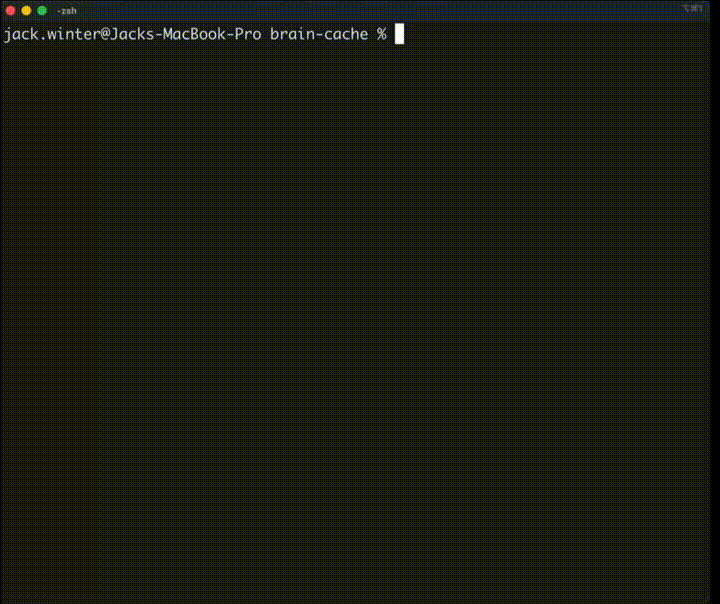

<p align="center">
  
</p>

> Stop sending your entire repo to Claude.

brain-cache is a local context engine for Claude Code. It indexes your codebase using AST-aware chunking — so when Claude needs context, it gets relevant code chunks, not a wall of files. Fewer tokens. Better answers. Runs entirely on your machine.

<p align="center">
  
</p>

---

## How it works

Most RAG tools split code by line count. brain-cache parses your source files into ASTs and chunks at function, class, and method boundaries — so a chunk is always a complete, meaningful unit of code, never an arbitrary slice of one.

At index time, brain-cache also records call and import metadata from supported AST forms. Retrieval combines semantic matches and exact symbol names. Trace queries follow direct calls to unambiguous module-level functions and const arrow functions within JavaScript/TypeScript files. Shadowed, reassigned, member, and cross-file targets remain unresolved. General dependency resolution and import expansion are not implemented; the recorded metadata is not a complete call graph.

Exact symbol-name matches are considered alongside semantic candidates and ranked first, so a definition can be found even when its embedding is a weak match. Keyword fallback also retrieves exact names separately from its broader candidate pool. Final result limits still apply.

Everything runs locally via Ollama. No embeddings leave your machine. No API calls for retrieval.

---

## Supported languages

AST-aware chunking:

- TypeScript / JavaScript (`.ts`, `.tsx`, `.js`, `.jsx`, `.mts`, `.cts`, `.mjs`, `.cjs`)
- Python (`.py`, `.pyi`)
- Go (`.go`)
- Rust (`.rs`)

Documentation files (`.md`, `.txt`, `.rst`) use a separate doc chunker and are included in retrieval. All other file types are skipped.

---

## Use inside Claude Code (MCP)

The primary way to use brain-cache is as an MCP server. Run `brain-cache init` once — it auto-configures `.mcp.json` in your project root so Claude Code connects immediately. No manual JSON setup needed. The generated entry uses absolute paths to the current Node executable and installed package, so both global and local installs work. Re-run `init` after moving the installation or changing Node installations.

Claude then has access to:

- **`build_context`** — Assembles relevant context for any question. Retrieves relevant code chunks and fits them to an approximate token budget. Use instead of reading files.
- **`search_codebase`** — Finds functions, types, and symbols by meaning, not keyword. Chunks at AST boundaries, so results are always complete code units. Use instead of grep.
- **`index_repo`** — Rebuilds the local vector index.

Also included: **`doctor`** — diagnoses index health and Ollama connectivity.

No copy/pasting code into prompts. No manual file opens. Claude knows where to look.

---

## Quick start

**Step 1: Install**

```
npm install -g brain-cache
```

Or as a project dev dependency:

```
npm install -D brain-cache
```

**Step 2: Init and index your project**

```
brain-cache init
brain-cache index
```

`brain-cache init` wires everything up: configures `.mcp.json` so Claude Code connects automatically, appends tool instructions to `CLAUDE.md`, installs the brain-cache skill to `.claude/skills/brain-cache/SKILL.md`, adds a status line showing cumulative token savings, and installs PreToolUse hooks that remind Claude to use brain-cache tools first. Runs once; idempotent.

**Step 3: Use Claude normally**

brain-cache tools are called automatically. You don't change how you work — the context just gets better.

> **Advanced:** Prefer the `.mcp.json` generated by `init`. For a custom configuration, replace both placeholder paths below with the absolute paths to your Node executable and the installed package’s `dist/mcp.js`. The MCP server has its own entry point; there is no `brain-cache mcp` CLI command.
>
> ```json
> {
>   "mcpServers": {
>     "brain-cache": {
>       "command": "/absolute/path/to/node",
>       "args": ["/absolute/path/to/brain-cache/dist/mcp.js"]
>     }
>   }
> }
> ```

---

## When Ollama is unavailable

With an existing index, `search_codebase` and `build_context` fall back to keyword matching and label the results accordingly. Context still respects its approximate token budget. Building or refreshing an index requires Ollama; fallback results reflect the last successful index.

## Keeping the index fresh

When an upgrade changes the chunk format, the next `brain-cache index` rebuilds older indexes once to adopt the latest format. Later indexing runs remain incremental. Existing indexes remain readable until that rebuild.

`brain-cache index` runs incrementally by default — unchanged files are skipped, so re-indexing a large repo after a few edits takes seconds, not minutes.

With Git-history ingestion disabled, unchanged indexes reuse their existing generation without copying storage or changing the indexed timestamp. `--verify` also checks content hashes before reuse; `--force`, missing metadata, and model/schema/format changes still trigger indexing.

Refreshes build a separate index generation and publish it only after its database and metadata are complete. Searches already in progress keep their original snapshot; new searches use the newly published generation. A failed refresh leaves the previous index available. Legacy indexes are migrated on their next successful refresh.

Each changed refresh copies the active index (using filesystem copy-on-write where available). Automatic cleanup keeps the active and previous generations, plus any older snapshots still used by readers in other processes. The next index run, including an unchanged run, collects released snapshots; pins from exited processes are reclaimed. Unknown reader ownership is retained conservatively. This bounds the number of unused managed snapshots, not the size of each database.

Legacy layouts and generations created before reader tracking remain until `brain-cache clean`, because older clients cannot register their readers. Stop older indexers before upgrading and restart MCP clients afterward. Published 4.0.9 and earlier clients do not understand generation storage and can keep reading the retained legacy index; intermediate builds that understand only version 1 pointers reject the new publication format. To downgrade, clean and reindex with the older build. `clean` removes all generations; run it when no searches are active, then reindex. Publication protects against interrupted indexing processes, not storage-device failure or power-loss durability.

For continuous sync, `brain-cache watch` runs a debounced incremental re-index on every file save. Note: file watchers may be flagged by enterprise EDR tools (Cortex XDR, CrowdStrike, etc.) due to their behavioural profile. If you're on a managed machine, incremental indexing via `brain-cache index` is the safer default.

---

## Install as Claude Code skill

brain-cache ships as a Claude Code skill. After `brain-cache init`, the skill is installed at `.claude/skills/brain-cache/SKILL.md` in your project. Claude automatically learns when and how to use brain-cache tools.

To install manually, copy the packaged `.claude/skills/brain-cache/SKILL.md` to the same path in your project.

`init` preserves an existing skill file, so re-running it after an upgrade does not refresh the skill. To update it, back up your project’s copy, compare it with the installed package’s `.claude/skills/brain-cache/SKILL.md`, and merge the changes while keeping your custom instructions. For a local install, the source is `node_modules/brain-cache/.claude/skills/brain-cache/SKILL.md`; for a global install, find the package under the directory printed by `npm root -g`.

---

## Status line

After `brain-cache init`, the status line in Claude Code's bottom bar shows estimated cumulative token savings session by session. These figures compare retrieved context with a modeled grep/read baseline; they are not measured billing savings.

---

## PreToolUse hooks

`brain-cache init` installs advisory hooks into Claude Code (`~/.claude/settings.json`) that fire before certain tools. They remind Claude to try brain-cache first — but never block execution.

| Tool triggered | Reminder                                                                |
| -------------- | ----------------------------------------------------------------------- |
| Grep           | Try `search_codebase` to find code by meaning instead of regex          |
| Glob           | Try `search_codebase` to locate files by meaning instead of pattern     |
| Read           | Try `build_context` to get relevant code instead of reading whole files |
| Agent          | Try `build_context` or `search_codebase` before spawning a sub-agent    |

Hooks are idempotent — re-running `init` updates brain-cache hooks without touching any other hooks you have configured.

---

## Tuning how much Claude uses brain-cache

`brain-cache init` adds a section to your project's `CLAUDE.md` with clear instructions to use brain-cache tools first. This works well for most users.

If you want to go further, you can strengthen the language yourself:

```
ALWAYS use brain-cache build_context before reading files or using Grep/Glob.
Do not skip brain-cache tools — they return better results with fewer tokens.
```

Or soften it if you prefer Claude to decide on its own. It's your `CLAUDE.md` — edit it to match how you want to work.

---

## CLI commands

The CLI is the setup and admin interface. Use it to init, index, debug, and diagnose — not as the primary interface.

```
brain-cache init                      Initialize brain-cache in a project
brain-cache index                     Build/rebuild the vector index (incremental by default)
brain-cache watch [path]              Watch project and run debounced incremental re-index on save
brain-cache search "auth middleware"  Manual search (useful for debugging)
brain-cache context "auth flow"       Manual context building (useful for debugging)
brain-cache ask "how does auth work?" Direct Claude query via CLI
brain-cache status                    Show index and system status
brain-cache clean                     Remove .brain-cache/ index directories
brain-cache doctor                    Check system health
```

---

`ask` uses `claude-sonnet-4-6` by default. Set `BRAIN_CACHE_CLAUDE_MODEL` to use another supported Anthropic model. Only `ask` sends retrieved context to the Anthropic API; indexing, search, and context assembly stay local.

## Token estimates

Context budgets and savings use an offline approximation. The bundled legacy Anthropic tokenizer is inaccurate for modern Claude models, so `maxTokens` is an approximate context budget, not a guaranteed API-token limit. MCP framing, instructions, and conversation history also add tokens outside that budget.

`ask` prints the API's actual input/output usage separately from the context estimate. Use that whole-request usage to assess real consumption; it cannot by itself measure the savings against a request you did not send. Indexing, search, and context assembly do not make cloud calls to count tokens.

## Requirements

- Node.js >= 22.12.0 (Node 22 or 24 LTS recommended)
- Ollama running locally (`nomic-embed-text` model recommended)
- Anthropic API key (for `ask` command only)

### Upgrading to 4.2

Version 4.2 updates LanceDB to 0.39. Indexes built by 4.1.x keep working
without a rebuild, and 4.1.1 can read indexes built by 4.2.

### Maintainer checks

`npm run verify:dist` builds and inspects the package, verifies the exact WASM
payload, installs the generated tarball, and smoke-tests the installed CLI.
`npm run eval:retrieval` runs the live Ollama retrieval benchmark and writes JSON
plus Markdown reports. CI uses `--deterministic` to validate the fixture and
metric pipeline without treating synthetic scores as a quality baseline.

`web-tree-sitter` remains on the latest compatible 0.25 release because the
published `tree-sitter-wasms@0.1.13` grammars are rejected by the 0.27 runtime.
The runtime can move to 0.27 once compatible grammar artifacts are available.

---

## Development checks

Run `npm ci` to install dependencies, then `npm run typecheck` to check source and test types and `npm test` for the ordinary unit and integration suite. The ordinary suite needs no registry access, Ollama service, or Anthropic key once dependencies are installed.

Run `npm run test:distribution` separately for packaging checks. It builds and installs the npm tarball in temporary local and global prefixes, checks CLI/MCP startup, and parses samples with all five bundled grammars. These checks require registry access but no Ollama service or Anthropic key.

CI runs typechecking, both test suites, and `npm audit` on Linux and macOS with the minimum Node 22.12.0 and Node 24.

The parser/WASM versions are paired intentionally: upgrade them together and rerun the grammar checks. The scoped `tsup`/`esbuild` override supplies security fixes while retaining the current build configuration; recheck it when upgrading the build tool.

## If this is useful

Give it a star — or try it on your repo and let me know what breaks.

---

## License

MIT — see LICENSE for details.
